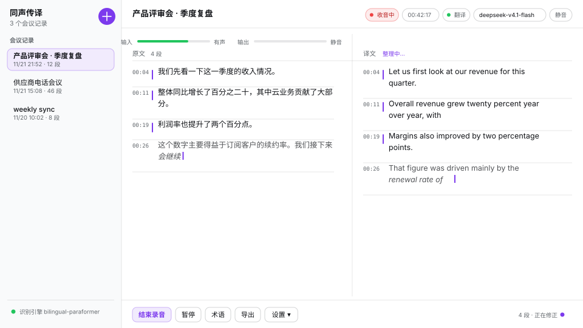

# dsh-live-interpreter

Simultaneous Chinese/English interpretation as a DSH Web bundle: streaming microphone audio, a loopback device (Stereo Mix / virtual cable) for the computer's own output, or both mixed, local sherpa-onnx recognition, continuous translation through the DSH model channel, and a row-aligned two-column panel with a project history and exports.



## Install

The package is published on **npm** and its source lives on **GitHub**. Either way it installs as a DSH bundle.

### From npm

```
pnpm add dsh-live-interpreter --node-linker=hoisted
```

(or `npm install dsh-live-interpreter`). `--node-linker=hoisted` is only needed with pnpm: its default symlinked layout makes sherpa-onnx-node's own platform-package lookup recurse until `ERR_PNPM_SYMLINK_FAILED`. npm's flat `node_modules` needs no flag.

### From a local clone

```
git clone https://github.com/Wang-Shuanglin/dsh-live-interpreter.git
cd dsh-live-interpreter
pnpm install --node-linker=hoisted
```

Then install the cloned directory as a bundle:

```
plugin_manager action: install_bundle, target: <absolute path to this directory>
```

### Models are downloaded, not bundled

The recognition models are **not** shipped in the package. On first use the panel offers a download (they land under `$DSH_HOME/dsh-live-interpreter/models/`), so an installing user needs network once and nothing else. No API key is required: translation goes through the DSH model channel using the user's own logged-in account — the plugin ships zero credentials.

After installation the bundle is active on the next page load. It adds:

- a **Live interpreter** entry to the sidebar's icon list and a `main` panel keyed `live-interpreter`;
- a **Live interpreter** section in Settings, and the same model card on the plugin's own page in the plugin manager;
- an `/interpret` command that opens the panel.

## How it works

| Path | Role |
| --- | --- |
| `lib/index.js` | Host half: registers a prefix route at `/dsh-live-interpreter/api` and the `/interpret` command, drives the per-meeting session, feeds PCM frames to the recognizer, and streams events over SSE. |
| `lib/asr.js` | sherpa-onnx `OnlineRecognizer` wrapper: one decoder per model, a stream per utterance, idle eviction. Utterance boundaries are decided by the session, not the recognizer — sherpa's own endpoint detector fires on every short intra-sentence pause and resets the stream, which shreds a sentence into fragments. |
| `lib/translate.js` | Translation prompts over `ctx.get('llm')`: draft, written style, paragraph, refine, sentence-aligned, and transcript repair, plus the prefix helpers that decide what text is stable enough to translate. |
| `lib/store.js` | Project store under `$DSH_HOME/dsh-live-interpreter/`: `index.json`, and `projects/<id>/{meta.json,turns.jsonl,exports/}`. |
| `lib/exporters.js` | Meeting minutes, bilingual record, source, translation, SRT, and Markdown renderers. |
| `lib/tts.js` | Local speech synthesis for the spoken translation: `OfflineTts` over the downloaded voice, WAV encoding, and a small on-disk cache. The host synthesizes, the browser plays the file, because only `HTMLMediaElement.setSinkId()` can route audio to a chosen output device — `window.speechSynthesis` cannot. Synthesis must pass `enableExternalBuffer: false`: the addon's default path hands sample data back through a V8 external buffer, which Electron refuses. |
| `lib/refine.js` | Offline re-hearing of a finished paragraph with SenseVoice (`OfflineRecognizer` + `modelConfig.senseVoice`), used to repair the streaming transcript and add punctuation before translating. Whisper was measured on the same audio and rejected: it dropped whole phrases and produced Traditional characters. |
| `lib/index.js` (session) | `finalizeSegment` runs three passes over a finished paragraph: local SenseVoice re-hearing, then a DSH transcript repair, then translation. The repair may only reword: its result must contain the original's characters in both directions or it is discarded. |
| `lib/vad.js` | Local speech/silence classifier (Silero VAD, ~0.6 MB). When installed it decides per frame whether the audio is speech, which lets the paragraph boundary fall on a real pause instead of an energy threshold that fan and USB self-noise keep above the noise floor. Missing or failing, it degrades silently to the energy threshold. |
| `lib/models.js` | Recognizer, refinement, VAD, and voice catalog plus the resumable downloader (`hf-mirror.com`, then Hugging Face, with per-entry direct `url` support for GitHub releases), with separate `asr`, `refine`, `vad`, and `tts` trees. |
| `lib/client.js` | Client half: the panel, the settings card, the sidebar icon, the AudioWorklet PCM tap (with a ScriptProcessor fallback), the resampler, the paragraph reader, and the **Settings ▾** drawer holding the recognizer / input / output selectors and the self-check buttons. It also owns capture: microphone, a loopback recording device (Stereo Mix / a virtual cable) for system audio, or both mixed into one graph. The transcript renders as a single scrolling grid of rows, each row holding the source cell and the target cell side by side, so a long translation and a short original share one row height and never drift apart. |

Audio never leaves the machine: the client downsamples to 16 kHz mono PCM, posts 240 ms frames to the host, and the recognizer runs in-process. Only recognized text reaches the model channel, and only when translating. Spoken translation is synthesized locally too; nothing calls a cloud speech service.

## Data

`$DSH_HOME/dsh-live-interpreter/` (default `~/.dsh/dsh-live-interpreter/`):

```
index.json                     project list, newest first
models/asr/<model-id>/         downloaded sherpa-onnx recognizers (4 catalog entries)
models/refine/<model-id>/      downloaded refinement recognizer (1 catalog entry, optional)
models/vad/<model-id>/         downloaded speech-activity detector (1 catalog entry, optional)
models/tts/<voice-id>/         downloaded voices (1 catalog entry)
speech/                        synthesized paragraph audio, pruned to the newest few
projects/<id>/meta.json        title, clock, status, glossary
projects/<id>/turns.jsonl      one JSON object per paragraph; the source of truth
projects/<id>/exports/         generated minutes, records, subtitles
```

Audio is not persisted.

## Tests

```
node test/smoke.mjs          # language detection, prefix folding, store, exporters (no model needed)
node test/asr-smoke.mjs      # loads the streaming model and decodes synthetic frames
node test/http-smoke.mjs     # drives the live instance over HTTP: projects, audio, exports, models
node test/translate-smoke.mjs # stores turns and asks the model channel to translate them
```

`smoke.mjs` reads `DSH_HOME`, so point it at a scratch directory before running it. The other three talk to the running DSH web instance (or the store) and expect the plugin to be installed.

## Releasing

```
npm publish --access public
```

Before publishing, run the smoke tests so a broken build never reaches the registry:

```
node test/smoke.mjs          # no model, no network
node test/translate-smoke.mjs # needs a running DSH web instance
```

`files` in `package.json` whitelists `lib`, `cordis.patch.yml`, `locale`, `docs`, `test`, `icon.svg`, `README.md`, and `LICENSE` — model weights, runtime meeting data, and `node_modules` are always excluded. `package.json` reads `repository`/`homepage`/`bugs` from a `your-username` placeholder; replace it with the real GitHub owner before publishing.

## License

MIT.
