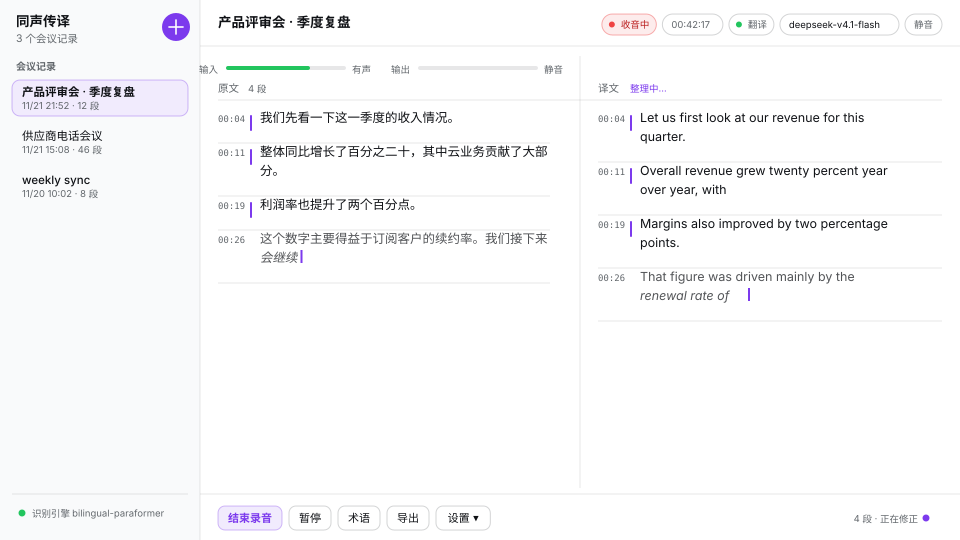

# Live interpreter

Bidirectional Chinese/English simultaneous interpretation. Pick the **Live interpreter** icon in the sidebar, press **Start**, and speak into the laptop microphone: the source appears on the left and the translation follows on the right. When a paragraph ends the translation is rewritten into written style, and afterwards you can export the meeting as minutes or as a bilingual record.

## Using it

1. **Open the panel**: the **Live interpreter** icon at the foot of the sidebar, or type `/interpret` in a conversation.
2. **First run**: open the **Settings ▾** drawer above the footer; its "Models needed" row reports the missing recognizer and offers a **Download** button (the default, Chinese/English Paraformer, is about 240 MB, fetched from hf-mirror.com once).
   - You can pick another recognizer: the drawer's **Recognition model** dropdown (the same list lives in Settings → Live interpreter) offers **Chinese/English fast** (int8, about 200 MB, lighter and quicker to start), **Chinese/English accurate** (fp32, about 355 MB, the most accurate but the heaviest on CPU), and **Chinese only, light** (about 25 MB, for slow machines; it does not recognize English).
   - The model can be switched at any time, but not while a meeting is recording.
   - Next to it sits an optional **recognition refinement** model (about 240 MB, SenseVoice). Streaming recognition has to surface words before the sentence is finished, so it drops syllables, confuses homophones, and produces no punctuation. The refinement pass re-hears the whole paragraph once it closes, fixes the text, adds punctuation, and the translation is redone from the corrected source. Install it and it applies automatically; without it everything still works, the subtitles are just rougher.
   - There is also a tiny **sentence-boundary detector** (Silero VAD, about 0.6 MB) that judges whether a paragraph is actually finished. Without it the panel falls back to a volume threshold, which fans and USB-interface self-noise keep above the noise floor, so "silence" is never reported and paragraphs end only when a timer fires — usually mid-sentence. With it, the boundary falls on a real pause and the transcript reaches the written-style pass sooner.
3. **Choose where the sound comes from**: the drawer has one **Sound source** control with three options. **Microphone** listens only to this machine's microphone (face-to-face meetings, lectures, audio played into the room). **System audio** listens only to what the computer itself plays (online meetings, web video). **Microphone + system audio** mixes both, for an online meeting where the room also has a voice.
   - **System audio** does not use the microphone and does not depend on Stereo Mix: a small local helper captures Windows' **default playback device** directly (WASAPI loopback). It hears whatever the computer plays — a USB speaker, a Bluetooth headset, or the onboard chip — with no screen sharing and no share dialog. It starts in the background when you press Start.
   - **System audio** needs **Python 3** on the machine plus two libraries, installed once: `pip install soundcard numpy`. Missing them is fine too: the first Start auto-runs `pip install soundcard numpy` and continues on success, and the panel gives the manual command if that install fails. Once installed there is no device to pick, it follows the default playback device automatically.
   - In **Microphone + system audio** the two paths are summed at one mixer, so speakers re-capture what the speakers play; headphones are recommended.
4. **Start**: press **Start**; the browser asks for microphone access, and a system source additionally starts the local system-audio helper in the background (the microphone half is still captured by the browser).
   - There is no "Chinese to English" or "English to Chinese" switch. Each utterance's language is detected and the direction follows automatically.
   - The source grows in three tiers: settled text is at full strength, the part the recognizer has stopped rewriting is slightly lighter, and italic text at the lowest strength is the newest guess that may still change. A blinking caret means speaking continues. A paragraph only reaches full strength once it closes. The first recognized word opens a new row, so the transcript is visible while the speaker is still talking.
   - Sentence boundaries follow whether the sentence is FINISHED, not a fixed pause: the boundary detector judges per frame whether it is speech, and on top of that a full stop or a clearly ended sentence (Chinese closing on 吧/了/呢, English stopping on a content word) closes it on a short pause. Chopping mid-thought into fragments was what produced the repeated garbage ("我我我对对六六").
   - The translation grows the same way: a word at first, a short sentence when one lands, and a cohesive written paragraph once the paragraph closes (marked with a theme-colored bar on the left). Wording already on screen is preserved and only the corrected part is rewritten.
   - **Both columns are rows of one grid**: when a paragraph holds several sentences, sentence N of the source and sentence N of the translation share one grid row, so the two sides always correspond; the taller side stretches the row and the shorter side keeps the leftover space. When the model fails to keep the sentence count the paragraph falls back to one whole row — a mismatched pairing is worse than no pairing.
   - The three tiers are one foreground color at three opacities, so they hold up in both the light and the dark theme and never put near-white text on a white background.
   - The panel shows `captured / sent / received` frame counts. If they stay at zero, see **When there is no sound** below.
5. **During the meeting**: **Pause** and **Resume** keep the transcript and stop capturing; **Stop recording** ends the audio. The 🔇 toggle controls spoken translations and is muted by default; read-aloud only fires for finished paragraphs, never per sentence.
6. **Translation model**: the dropdown at the top right picks which DSH model translates (it lists every provider and model you are signed in to). The choice is stored with the meeting and reused when you reopen it; it cannot be changed while recording.
7. **Read-aloud device**: Settings → Live interpreter → **Read translations aloud** picks the output device (headphones or speakers); the **Settings ▾** drawer carries the same dropdown next to **Test read-aloud**. Speech is synthesized locally by a downloadable voice (about 60 MB) and never goes to an online speech service.
8. **Glossary**: the **Terms** button takes one `source = target` pair per line (for example `roadmap = 路线图`); recognized terms are then pinned to those translations.
9. **Afterwards**: press **Stop recording** to close the last paragraph, then **Export** offers meeting minutes, a bilingual record, source only, translation only, subtitles (SRT), or Markdown. The file downloads straight to your browser's download folder; it is also kept under `exports/` in the data directory.
10. **History**: each meeting is a project in the left rail of the panel; open one again to review or re-export it.

## When there is no sound

1. **Use the desktop window**: the desktop build only grants the microphone to DeepSeek Harness's own window (`dsh-app://app`). Opening `127.0.0.1:xxxx` in an ordinary browser tab is refused outright by system policy, and the panel says so.
2. **Press Test microphone**: open the **Settings ▾** drawer; that button only reads levels and does not start recognition. It tests the path the current **Sound source** selects — a system source tests the system-audio capture.
3. **Pick another input device**: the drawer's **Input device** dropdown selects one explicitly. With Bluetooth headsets Windows often splits "headset microphone" and "hands-free" into two devices, and the wrong one is silent.
4. **Read the diagnostic line**: it separates the cases — no frames captured at all, frames captured but none received, frames received but all silent, and voice received but no paragraph yet.
5. **System audio still silent**: first confirm Python 3 is installed (`python --version`). If the panel reports an automatic-install failure, run `pip install soundcard numpy` and try again; if it starts but stays silent with no error, the computer is probably playing nothing right now (system audio captures only what is playing), or the meeting app switched the output device — make sure the default playback device is the one actually sounding, then play the meeting again.

## What it runs on

- **Recognition**: sherpa-onnx streaming models running locally; audio never leaves the machine. The default is the Paraformer bilingual int8 model, and the Zipformer fast or fp32 accurate versions can be selected in the **Settings ▾** drawer.
- **System-audio capture**: a local WASAPI loopback helper (Python + soundcard) that grabs the default playback device itself — not the microphone and not Stereo Mix; that audio stays on the machine too.
- **Sentence boundary**: a local Silero VAD (about 0.6 MB) judges per frame whether the audio is speech; sentence and paragraph boundaries come from it and the semantic checks together.
- **Refinement**: a local SenseVoice int8 model re-hears each finished paragraph once and replaces the streaming result before translating. That audio stays on the machine too.
- **Translation**: the DSH model channel (`llm`), using the account you already signed in with; the model itself is chosen in the panel's top-right dropdown. No extra API key is needed.
- **Transcript repair**: after a paragraph closes, the same DSH text model also reads the recognized text once (fixing homophones, adding punctuation, applying the glossary). It may only change wording, never meaning: the result must still contain the original's characters both ways or it is dropped. This repair runs in parallel with translation, so it does not delay the first translated word.
- **Read-aloud**: a local VITS voice renders a WAV that the browser plays, which is the only way to target a chosen output device.

## On getting more accuracy

- The higher-accuracy options that exist have all been tried: streaming Paraformer (now the default), streaming Zipformer fp32, and the SenseVoice refinement pass. Together they are the ceiling for what runs on this machine.
- **Cloud recognition is not available**: the plugin only talks to DSH's own services, and this DSH installation has no usable cloud speech-to-text service, so "switch to a cloud ASR for better accuracy" is not an option here. The only networked part is the translation model you are already signed in to.
- **Whisper measured worse**: on the same test audio, Whisper base dropped whole phrases ("the day after" disappeared), produced Traditional Chinese characters, and ran slower than SenseVoice — so it is not used.
- The most effective improvement is not a different model: fill in the glossary beforehand (product names, acronyms, people) and pause briefly at the end of a sentence.

## Limitations

- **Audio source**: **Microphone** listens only to the local microphone. **System audio** grabs the default playback device directly (WASAPI loopback) — online meetings, lessons, and web video need no screen sharing and no Stereo Mix, but do need Python 3 (the `soundcard` and `numpy` libraries install themselves on first use). **Microphone + system audio** mixes both.
- **Latency**: the source appears about 0.2 to 0.6 seconds after the words are spoken (the first recognized word opens a row), and the translation draft follows immediately — the first word typically lands within a second. The written-style rewrite arrives after roughly 1.8 seconds of real silence; it blocks neither the display nor the next sentence. An unbroken monologue is closed as a paragraph every 45 seconds.
- **Accuracy**: recognition and translation are produced live by models, so names, numbers, heavy accents, and people talking over each other can come out wrong. Filling the glossary before a meeting helps noticeably, and the default Paraformer model is the better choice when zh/en speech is mixed.
- **Data**: meeting text is stored in `$DSH_HOME/dsh-live-interpreter/` (`~/.dsh/dsh-live-interpreter/` by default) and audio is not saved. Turning the plugin off leaves those files in place.
- **Model availability**: when DSH is signed out or no model is available, the plugin drops to recognition-only and shows the source alone.
- **Interruption is safe**: if a paragraph's finalization fails (model timeout, network drop), its recognized source is still written to the transcript rather than silently lost; only the translation is missing, and it can be retranslated or exported later.
