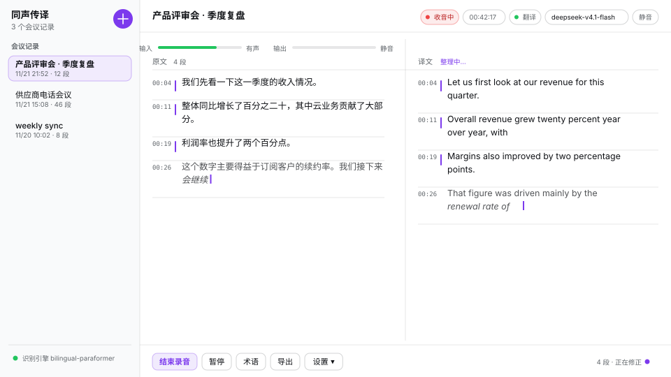

# 同声传译

边说边译的中英同声传译。点开左侧栏的「同声传译」图标，按「开始同传」，对着笔记本麦克风说话：左边出现原话、右边同步出现译文，一段话讲完时译文会自动整理成书面语；会议结束后可以把这一场导出成会议纪要或双语记录。

## 怎么用

1. **打开面板**：点左侧栏底部的「同声传译」图标，或在会话里输入 `/interpret`。
2. **第一次使用**：点底栏的「设置 ▾」展开抽屉，「需要的模型」一栏会提示识别模型未下载，点「下载」即可（默认的「中英双语 · Paraformer」约 240 MB，从 hf-mirror.com 下载，只需一次）。
   - 想要更省内存或机器较慢可以换模型：抽屉里的「识别模型」下拉框（设置 → 同声传译里是同一份列表）可以选「中英双语 · 快速」（int8，约 200 MB）、「中英双语 · 高精度」（fp32，约 355 MB，最准但最吃 CPU），或「中文 · 轻量」（约 25 MB，只在全程说中文且机器较慢时选它，它不认英文）。
   - 模型可以随时换，开始同传之后不能换。
   - 旁边还有一项可选的「识别精修」（约 240 MB，SenseVoice）：流式识别为了赶时间必须先出字，所以会掉字、同音字错、没有标点；精修在一段话定稿后把这段音频整段重听一遍，纠正错字并补上标点，再用精修后的原文重译。装上就自动生效，不装也能用，只是字幕会粗一些。
   - 还有一项很小的「断句检测」（Silero VAD，约 0.6 MB）：判断「一段话到底说完没有」。没有它时只能靠音量大小猜，风扇声、USB 声卡底噪都会让电平一直高于静音阈值，于是永远等不到「安静」，段落只能靠定时器硬切，切口常落在句子中间。装上之后按声音内容判断，段落边界落在真实停顿上，字幕也就能更早走到「整理成书面语」那一步。
3. **选声音从哪来**：抽屉里的「声音来源」有三个选项 ——「麦克风」只听你这台电脑的麦克风（面对面开会、听讲座）；「系统声音」只听电脑自己正在播放的声音（线上会议、网页视频）；「麦克风 + 系统声音」两路一起听，适合线上会议里既有人从电脑里说话、你自己也要插话的场景。
   - 「系统声音」不走麦克风、也不依赖「立体声混音」，而是由一个本地小助手直接抓取 Windows 的**默认播放设备**（WASAPI 回环）。无论声音是从 USB 音箱、蓝牙耳机还是板载声卡放出来，它都能原样收到；**不需要共享屏幕、不会弹共享对话框**。开始同传时它自动在后台启动。
   - 「系统声音」需要本机装好 **Python 3**，并装两个库：`pip install soundcard numpy`（只装一次）。**没装也没关系**：第一次开始同传时会自动尝试 `pip install soundcard numpy`，装好就自动继续；自动安装失败时面板会提示手动执行。装好后不需要选设备，它自动跟随系统默认播放设备。
   - 「麦克风 + 系统声音」时两路在同一个混音点相加，所以外放会把音箱里的声音再收一遍，建议戴耳机。
4. **开始同传**：按「开始同传」，浏览器会请求麦克风权限，允许即可。选了系统声音时会在后台启动那个抓系统音的小助手（麦克风那一路照常由浏览器采集）。
   - 不需要选择「中译英」还是「英译中」：程序按每一句话自动判断说话人语言，中文就译成英文、英文就译成中文。
   - 原文分三段显现：正常黑字是已经稳定的部分，稍浅的字是识别器正在回调的上文，最浅的斜体字是最新的猜测（还会变），末尾的闪烁光标表示还在说。整段话讲完（停顿够久）才整段转成满强度黑字。
   - 断句按「话有没有说完」判断，不是按停顿硬切：装了「断句检测」时由它判断这一帧是不是人在说话，段落边界落在真实停顿上；没装时退回音量阈值，再加上「识别器给出句号、或句子明显说完（中文以「吧/了/呢」这类收束词结尾、英文停在实词上）」的语义判断。切成碎片再重新识别，正是以前出现「我我我对对六六」这种重复乱码的原因。
   - 译文同样是一段一段长出来的：刚开口时只有一个词，说完一句是一个短句，整段讲完再整理成书面语（左侧带主题色竖条）。已经显示出来的措辞会尽量保留，只改被修正的部分，所以右栏不会整段跳来跳去。
   - **两栏是同一张表格的行**：一段里有多句话时，第 N 句原文和第 N 句译文在同一个格子行里，左右一定对应；某一边字数多就把这一行撑高，空隙留在短的那一边，不用再自己找哪句对哪句。模型没能保持句数一致时退回整段一行（错行比对不齐更糟）。
   - 三档深浅用的是同一个前景色的透明度，所以浅色主题和深色主题下层次都成立，不会出现白底白字。
   - 面板会显示「采到 N 帧 · 已送 N 帧 · 宿主收到 N 帧」，如果一直是 0，请看下面的「没声音怎么办」。
5. **过程中**：可以「暂停」（保留当前内容，停止收音）、「继续」、「结束录音」。顶栏的 🔇 开关控制是否朗读译文，默认静音；朗读只在整段定稿后才出声，避免一句一停。
6. **翻译模型**：顶栏右上的下拉框可以在同传开始前换用哪个 DSH 模型来翻译（列表就是 DSH 里已登录、已配置的全部 provider 与模型）。这个选择会存进当前会议，重新打开时沿用；开始同传之后不能换，中途换模型会让同一场会议的文风前后跳。
7. **朗读到指定设备**：设置 → 同声传译 →「译文朗读」里可以选输出设备（耳机 / 扬声器）；面板的「设置 ▾」抽屉里也有同一个下拉框，旁边就是「试听朗读」，按一下两秒内就能确认声音去了哪儿。朗读用本机合成的音色（约 60 MB，需另外下载一次），不调用任何在线语音服务。
8. **术语**：「术语」按钮可以一行一条填「原文 = 译法」（例如 `roadmap = 路线图`），识别到的专有名词会按这里的译法固定下来。
9. **结束后**：先按「结束录音」收尾，再按「导出」，选择导出会议纪要、双语对照、纯原文、纯译文、字幕（SRT）或 Markdown。选完会直接下载到浏览器的下载目录；文件本身也存在数据目录的 `exports/` 下，面板里可以再次点开下载。
10. **历史项目**：左侧栏面板里每一场会议都是一个项目，点一下即可重新打开查看或继续导出。

## 没声音怎么办

1. **确认在桌面应用里**：桌面版只把录音授权给 DeepSeek Harness 自己的窗口（`dsh-app://app`）。在普通浏览器标签页打开 `127.0.0.1:xxxx` 会被系统策略直接拒绝，面板会明确提示这一点。
2. **点「测试麦克风」**：展开底栏的「设置 ▾」抽屉，这个按钮只读电平、不启动识别。上方绿色输入电平不动，就说明问题在采集侧（权限 / 设备 / 系统静音），不是识别模型。它测的是当前「声音来源」选的那一路，选了系统声音就是测系统音采集。
3. **换输入设备**：抽屉里的「输入设备」下拉框可以指定设备。插着蓝牙耳机时，Windows 常把「耳机麦克风」和「免手持通话」分成两个设备，选错那个就没有声音。
4. **看面板的诊断行**：它会区分几种情况 —— 一帧都没采到（音频处理没跑起来）、采到了但宿主收到 0 帧（上传被挡）、宿主收到了但全静音（设备静音或选错）、收到了声音但还没凑成一段（继续说，句末停一下）。按提示处理即可。
5. **选了「系统声音」还是没声**：先确认本机装了 Python 3（`python --version`）。若面板报「自动安装失败」，手动执行 `pip install soundcard numpy` 再试；若一直静音且没报错，多半是电脑此刻没有播放任何声音（系统音采集只收「正在播放」的内容），或会议软件把输出设备切走了——确认默认播放设备就是正在出声的那个，然后把会议声音放出来再试。

## 它用什么

- **识别**：本机运行 sherpa-onnx 流式模型，音频不出本机。默认是 Paraformer 中英双语 int8，可在「设置 ▾」抽屉里换成 Zipformer 快速版或 fp32 高精度版。
- **系统音采集**：本机 WASAPI 回环小助手（Python + soundcard），抓的是 Windows 默认播放设备本身，不经过麦克风、也不依赖「立体声混音」；音频不出本机。
- **断句检测**：本机 Silero VAD（约 0.6 MB），逐帧判断「这一帧是不是人在说话」，段落与句子边界由它和语义判断共同决定。音频不出本机。
- **识别精修**：本机 SenseVoice（int8），只在一段话定稿后对这一段音频重听一次，替换掉流式结果再重译，音频同样不出本机。
- **翻译**：走 DSH 自己的模型通道（`llm` 服务），使用你已登录的账号；用哪个模型可以在面板顶栏的下拉框里选，不另外要求 API Key。
- **原文校正**：一段话定稿后，除了本机 SenseVoice 重听，还会用同一个 DSH 文本模型把识别结果通读一遍（修同音字、补标点、按术语表纠错）。它只改文字不改意思，改完还会和原文做一次互相包含度检查，通不过就丢弃——宁可留着没修干净的字，也不能让模型把原话改写掉。这一步与翻译是并行发起的，不会把译文的出现时间往后拖。
- **朗读**：本机 VITS 音色合成成 WAV，再交给浏览器播放，这样才能指定输出设备。

## 关于「更准」这件事

- 已经试过的更高精度方案：流式 Paraformer（现在默认）、流式 Zipformer fp32、「识别精修」SenseVoice。三者叠起来就是本机能做到的上限。
- **联网识别做不到**：这个插件只走 DSH 自己的服务，而当前 DSH 安装里没有可用的云端语音识别服务，所以没有「改用云 ASR 更准」这条路。唯一的联网部分是已登录的翻译模型。
- **Whisper 实测更差**：用同一批测试音频对比，Whisper base 会整段漏字（「the day after」整句没识别出来）、中文会出繁体字，比 SenseVoice 差且更慢，所以没有采用。sherpa 支持 Whisper，但这里不划算。
- 想进一步提升，最有效的不是换模型，而是会前在「术语」里填一份术语表（专有名词、缩写、人名），以及说话时句末稍作停顿。

## 需要注意

- **声音从哪来**：「声音来源」选「麦克风」只听本地麦克风，最适合面对面开会、听讲座、看视频时把手机/音箱的声音收进来；选「系统声音」直接抓电脑默认播放设备（WASAPI 回环），线上会议、网课、网页视频都能用，**不依赖「立体声混音」、不需要共享屏幕**，但要本机装 Python 3（`soundcard`、`numpy` 两个库缺了会自动装）；选「麦克风 + 系统声音」两路混合。
- **延迟**：从说出口到原文出现，正常在 0.2~0.6 秒（第一个认出来的词就会开出新的一行，不再等整句定稿）；译文草稿紧随其后，第一个字通常在开口后 1 秒内出现。整段讲完、安静约 1.8 秒后会有一次书面语整理（不阻塞显示，也不阻塞下一句识别）。一次连续不停顿的独白最多 45 秒会自动收一段，免得字幕一直不落段。
- **文案准确度**：识别与翻译都由模型实时产出，专有名词、数字、口音较重或多人抢话时可能出错。会前在面板的「术语」里填一份术语表能明显改善；默认的 Paraformer 模型在中英混说时本来就比快速模型更稳。
- **数据**：会议文本保存在 `$DSH_HOME/dsh-live-interpreter/`（默认 `~/.dsh/dsh-live-interpreter/`），音频不会被保存。关掉插件后这些文件仍然保留，可自行删除。
- **模型可用性**：如果 DSH 没有登录或模型不可用，插件会进入「只识别、不翻译」模式，只显示原文，不会静默改用第三方翻译服务。
- **中断也不丢**：某一段的整理过程如果出错（模型超时、网络断开），这一段的原文仍会写进记录，不会被静默丢掉；只是那一段没有译文，可以之后再导出或重译。
